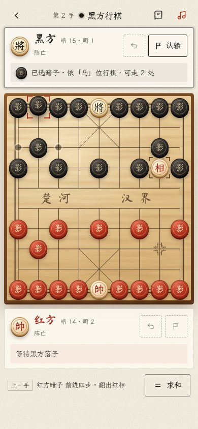

# 影翻棋 ShadowFlip

> 象棋 · 暗子变体 —— Chinese chess, played in the shadows.

除帅与将，三十枚棋子尽数扣置，红黑混洗、随机落位。暗子依开局位置的兵种行棋，一动即翻——你推出去的那一子，未必是自己人。

影翻棋是一款纯前端的网页游戏：双人同屏对弈，打开浏览器即玩，无需安装、无需构建。


| 对局 · 桌面 | 对局 · 手机 |
| --- | --- |
|  |  |

## 特色

- **暗子玩法**：朱漆暗子归红方调遣，黑漆暗子归黑方调遣；暗子按开局位置的兵种行棋，落定即翻面，翻出来的可能是对手的棋子。
- **完整对局流程**：悔棋（有条件）、认输（仅限己方回合）、求和（对方同意）、对脸将判定、吃将判胜。
- **走子动画**：棋子滑动、暗子绕 Y 轴翻面、吃子淡出，终局落梅飘洒、掌声响起。
- **音效与配乐**：落子、吃子、悔棋音效，三首背景音乐随机轮播，可一键静音（偏好会被记住）。
- **适配桌面与手机**：桌面三栏布局，手机上面板叠放在棋盘上下。
- **无障碍**：每个交叉点都是可聚焦按钮，支持方向键移动、回车/空格落子、Esc 取消选择；尊重系统「减少动态效果」设置。

## 快速开始

### 1. 克隆仓库

```bash
git clone https://github.com/AntlerPotato/ShadowFlip.git
cd ShadowFlip
```

### 2. 打开游戏

项目没有任何依赖，以下任选一种：

- **直接打开**：双击 `index.html`，在浏览器中点「开始对局」。
- **本地静态服务器**（推荐，行为与线上一致）：

  ```bash
  # Python 3
  python3 -m http.server 8080

  # 或 Node.js
  npx serve .
  ```

  然后访问 <http://localhost:8080>。

> 字体（霞鹜文楷 TC、马善政楷书、智莽行书、Cormorant Garamond）从 Google Fonts 加载；离线时会回退到系统楷体，不影响对局。

### 3. 部署到 GitHub Pages

仓库 **Settings → Pages**，Source 选 **Deploy from a branch**，分支选 `main`、目录选 `/ (root)`，保存后稍等片刻即可通过 `https://<用户名>.github.io/ShadowFlip/` 访问。

## 规则速览

| 兵种 | 走法 |
| --- | --- |
| 帅 · 将 | 九宫之内横竖走一步；两将不得在同一直线上无子相隔、正面相对 |
| 车 | 横竖直行，途中不能越子 |
| 马 | 走「日」字，「马脚」被占则跳不过去 |
| 炮 | 移动同车；吃子须隔一子作「炮架」 |
| 相 · 象 | 走「田」字，「象眼」被堵不能飞；**可以过河** |
| 仕 · 士 | 斜走一格；未翻开时限于九宫，**翻开后全盘可走** |
| 兵 · 卒 | 过河前只能前进一步；过河后可前进或左右平移 |
| 暗子 | 按所在开局位置的兵种行棋，落定后翻面；任何棋子都可以吃暗子 |

- **胜负**：吃掉对方的帅或将即告胜利。
- **悔棋**：刚走完的一方可在对手落子前收回这一步；该子与被吃之子都须已翻开，且该子此前至少走过一步。翻子之步，落子无悔。
- **认输**：只能在己方回合认输。
- **求和**：一方提议，对方同意，即以和棋收场。

完整条文见 [Rules.md](Rules.md)，对局中也可随时点右上角「规则」查看。

## 项目结构

```
ShadowFlip/
├── index.html          落地页
├── game.html           对局页
├── favicon.svg
├── css/
│   ├── base.css        色彩与字体变量、棋子、印章、按钮
│   ├── landing.css     落地页样式
│   ├── game.css        对局页：顶栏、双方面板、棋盘
│   └── dialogs.css     轻提示、确认框、胜负结果、规则卷轴
├── js/
│   ├── engine.js       规则引擎（不依赖 DOM，浏览器与 Node 共用）
│   ├── audio.js        音效与背景音乐
│   ├── dialogs.js      弹窗与提示组件
│   └── game.js         对局界面与交互
├── media/              音效与背景音乐
├── tests/
│   └── engine.test.js  规则引擎单元测试
├── docs/images/        README 截图
├── Rules.md            完整规则
└── LICENSE
```

## 开发与测试

页面直接用原生 HTML、CSS、JavaScript 编写，改完刷新浏览器即可看到效果。

规则全部集中在 `js/engine.js`，单元测试使用 Node.js 自带的测试运行器（需要 Node.js 21 及以上）：

```bash
npm test
```

## 浏览器支持

最近两年内的 Chrome、Edge、Safari、Firefox（桌面与手机）。用到了原生 `<dialog>`、CSS 容器查询单位等特性。

## 参与贡献

欢迎提 Issue 或 Pull Request：

1. Fork 本仓库并新建分支：`git checkout -b feature/your-idea`
2. 修改后运行 `npm test` 确认规则测试通过
3. 提交并推送，发起 Pull Request

## English

**ShadowFlip** is a browser-based Chinese Chess (Xiangqi) variant for two players on one screen. Apart from the two generals, all thirty pieces start face-down and shuffled across both sides. A hidden piece moves according to the piece type of its starting square and flips over as soon as it lands, revealing its true type and side, which may belong to your opponent. Clone the repo and open `index.html`, or serve the folder with any static server. No build step and no dependencies. Run `npm test` for the rules engine tests.

## 许可

本项目基于 [MIT License](LICENSE) 开源。
